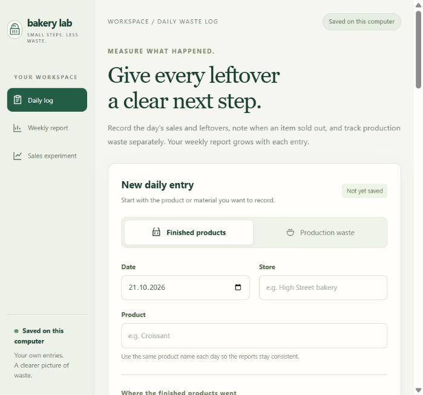

# Bakery Lab

Record bakery leftovers, review a week, and keep a full backup of your log.

**Open source · MIT licence · Local data storage**

[Source code and issues](https://github.com/fortikday/bakery-lab)

Bakery Lab is an early prototype. It records finished-product items and
production-waste kilograms separately, with CSV import, editing, archive
recovery, and comparisons between recorded weeks. No bakery pilot or measured
waste savings are documented yet.



## Use the app

**Portable Windows package:** extract the complete folder and double-click
`BakeryLab.exe`. This 64-bit Windows package includes Python and opens the app
in your browser. Keep its running window open while using the app; you can
minimize it. Close that window when finished. It also shows the data folder.

**Source ZIP from GitHub:** this contains the code and needs Python 3.11 or newer.
On Windows, double-click **Start Bakery Lab.cmd**. On other computers, or to
use the browser-only launcher, run:

```sh
python serve.py
```

On macOS or Linux, use `python3 serve.py` if your Python command is `python3`.

The daily log needs no extra Python packages. A portable build is a separate
download from GitHub's **Code → Download ZIP** source archive.

Follow the [bakery guide](docs/BAKERY_GUIDE.md) for daily recording, CSV imports,
weekly reports, data locations, and recovering a backup.

## Keep records safe

Use **Download full backup** in the app. It includes every week and store,
archived records, and revisions. The app also keeps daily recovery copies after
successful changes. Those copies stay on this computer; keep downloaded backups
somewhere safe outside the device as well. Backup status and failures appear in
the app. No automatic deletion of recovery files is performed.

Each installation has its own records. This version has no shared hosting,
accounts, or multi-device sync. Keep the server local as described in
[SECURITY.md](SECURITY.md).

## Learn or contribute

- **Learn Python and ML:** [forecasting experiment guide](docs/FORECASTING.md).
  It uses public scaled sales, stays separate from local bakery entries, and
  does not give baking recommendations.
- **Improve the project:** [contribution guide](CONTRIBUTING.md). Bug reports,
  clearer instructions, accessibility improvements, and bakery feedback are welcome.
- **Test it with a bakery:** [small pilot plan](docs/PILOT.md).
- **Build the Windows package:** [packaging instructions](packaging/README.md).

Anyone can use, modify, and share the code under the [MIT licence](LICENSE).
The public dataset retains its separate MIT notice in
[THIRD_PARTY_NOTICES.md](THIRD_PARTY_NOTICES.md). Keep real bakery records,
backups, and credentials out of public issues and contributions.
